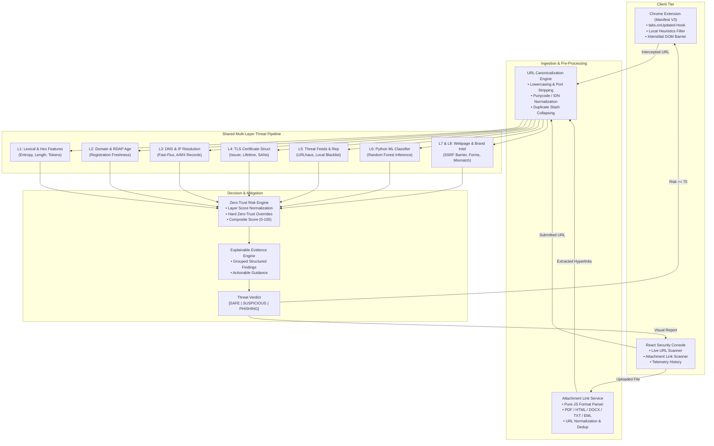

# PhishNetra — System Architecture & Threat Mitigation Framework

**Project:** PhishNetra — A MultiLayered AI-Driven Zero-Trust Framework for Real-Time Phishing Detection and Browser-Level Threat Mitigation  
**Specification:** Academic Major Project Framework  
**Authoritative Documents:** [`docs/PROJECT_SCOPE.md`](PROJECT_SCOPE.md) • [`docs/SCOPE_AUDIT.md`](SCOPE_AUDIT.md) • [`docs/ROADMAP.md`](ROADMAP.md)  

---

## 1. Architectural Overview & Component Topology

PhishNetra unites browser-level real-time navigation defense with backend multi-layer threat intelligence and email attachment link extraction. All inputs (browser URLs, direct user submissions, batch jobs, and attachment links) flow through a single, shared canonicalization and multi-layer risk engine.

---

## 2. Component Specifications

### 2.1 Chrome Manifest V3 Browser Extension (`apps/extension`)
The browser extension is the primary deliverable for user-facing protection.
- **Interception Lifecycle:** Monitors navigation requests via `tabs.onUpdated`. Captures URLs before DOM rendering.
- **Client-Side Pre-Filtering:** Rapid sub-millisecond evaluation in the background service worker:
  - Shannon entropy calculation.
  - Punycode / homoglyph confusables detection.
  - IP-literal hostnames (`http://192.168.1.1/login`).
  - Whitelist bypass lookup.
- **Backend Dispatch:** Asynchronous HTTP `POST /api/analyze` request to the PhishNetra Express API.
- **Mitigation Interstitial Overlay (`interstitial.ts`):** When the composite risk score is $\ge 70$ or the verdict is `PHISHING`, the content script injects an un-bypassable DOM security barrier.
  - Freezes host page input and scrolling.
  - Presents threat indicators, ML confidence, and composite risk score.
  - Enforces three conscious user choices: **Return to Safety**, **Inspect Evidence on Web Console**, or **Bypass & Proceed**.

### 2.2 Email Attachment Link Analyzer (`AttachmentAnalysisService.ts`)
Solves the vector where phishing destinations are distributed within email attachments rather than directly in the email body.
- **Supported Formats:**
  - **PDF:** Extracts hyperlink action dictionaries (`/Type /Action /S /URI /URI (...)`), hex-encoded URIs, and link annotations.
  - **HTML:** Parses anchor tags (`<a href="...">`), form submission targets (`<form action="...">`), and `<meta http-equiv="refresh">` redirects.
  - **DOCX:** Inspects OpenXML relationship targets (`Target="http..."`) within document relationship parts.
  - **TXT / EML:** Normalizes and extracts plain text URLs and defanged links (`hxxp://`, `[.]`).
- **Safety Boundary:**
  - Pure-JS string and stream inspection; **never executes macros, active content, or binary payloads**.
  - Strict 10MB file size ceiling with timeout protections.
  - Enforces a clear distinction between `NO_SUSPICIOUS_URLS_FOUND` (clean document) and `UNABLE_TO_ANALYZE` (unsupported format or corrupted payload).

### 2.3 Shared Threat Analysis Pipeline (`apps/api` & `services/ml`)
A unified pipeline that evaluates all URLs:
1. **Canonicalization:** Standardizes schemes, removes redundant ports, converts Punycode/IDN homoglyphs, and cleans paths.
2. **Layer 1 (Lexical):** 16 deterministic features extracted from URL tokens, path depth, parameter count, and entropy.
3. **Layer 2 (Domain/RDAP):** Evaluates domain registration age. Newly registered domains (< 14 days) trigger zero-trust flags.
4. **Layer 3 (DNS/IP):** Resolves A, AAAA, MX, and NS records. Validates against fast-flux infrastructure and bogon IP allocations.
5. **Layer 4 (TLS):** Inspects certificate authority, validity periods, and SAN structures.
6. **Layer 5 (Reputation):** Cross-references local caching and live blacklist feeds (URLhaus, OpenPhish).
7. **Layer 6 (Machine Learning):** FastAPI service running a calibrated Random Forest classifier (`scikit-learn`) returning confidence intervals and SHAP feature attributions.
8. **Layer 7 & 8 (Webpage Content & Brand Consistency):** Ephemeral sandboxed page rendering evaluating cross-origin password forms, hidden credential traps, and brand logo/domain mismatches.

---

## 3. Zero-Trust Security Guarantees & Safeguards

| Threat Vector | Mitigation Strategy & Security Control |
| :--- | :--- |
| **Server-Side Request Forgery (SSRF)** | Pre-flight DNS validation rejects IPv4 loopback (`127.0.0.0/8`), RFC 1918 private subnets (`10.0.0.0/8`, `172.16.0.0/12`, `192.168.0.0/16`), link-local addresses (`169.254.0.0/16`), and AWS/GCP cloud metadata endpoints (`169.254.169.254`). |
| **DNS Rebinding** | Re-validates the resolved IP immediately before TCP socket connection; aborts if resolved target points to an internal boundary. |
| **Malicious Attachment Code Execution** | Attachments are parsed in memory using declarative regular expressions and XML/text decoders without invoking external native shell utilities or document renderers. |
| **Browser Extension Snooping** | Content scripts operate with minimal Manifest V3 permissions (`activeTab`, `storage`, `scripting`). Form inputs, credentials, and unrelated browsing history are never read or stored. |
| **Silent Navigation Bypasses** | Interstitial overlays are injected directly into the active tab DOM with `z-index: 2147483647` and page scroll locking. Automated silent redirects are strictly forbidden. |
| **Fail-Safe Principle** | Incomplete intelligence or network timeouts never default to a `SAFE` verdict. Unknown or failed analyses receive `SUSPICIOUS` or `UNABLE_TO_ANALYZE`. |
