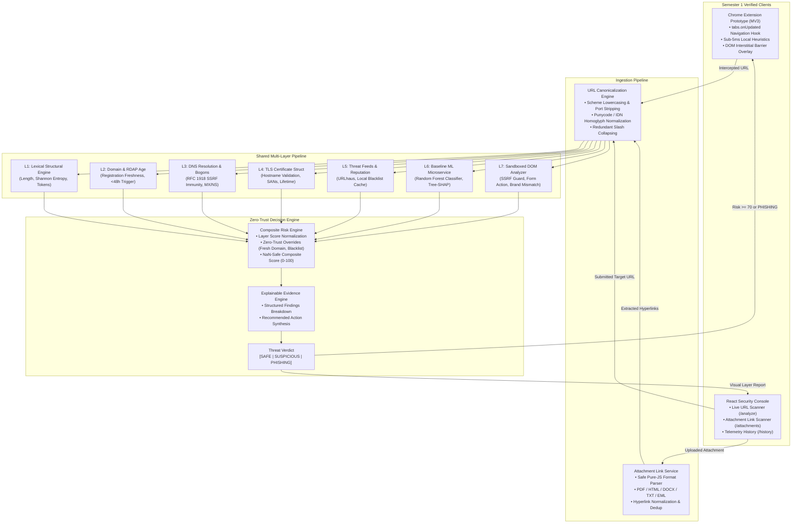
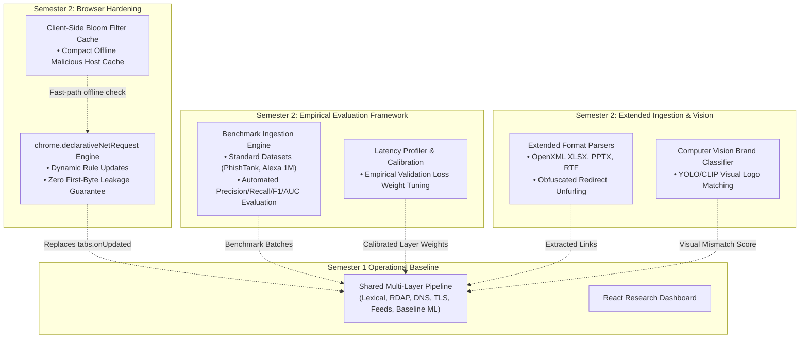

# PhishNetra — System Architecture & Implementation Topology

**Official Project Title:** PhishNetra — A MultiLayered AI-Driven Zero-Trust Framework for Real-Time Phishing Detection and Browser-Level Threat Mitigation  
**Specification:** Academic Major Project Framework (Two-Semester Architecture)  
**Authoritative Documents:** [`docs/PROJECT_SCOPE.md`](PROJECT_SCOPE.md) • [`docs/SEMESTER_MILESTONE_AUDIT.md`](SEMESTER_MILESTONE_AUDIT.md) • [`docs/ROADMAP.md`](ROADMAP.md)  

---

## 1. Semester 1 Operational Architecture (Current Working State)

The diagram below reflects the **verified Semester 1 architecture** operational in the repository today. Inputs from the web console, browser extension prototype, and email attachments pass through a single canonicalization engine and shared multi-layer risk pipeline.

---

## 2. Semester 2 Planned Architectural Evolution

The diagram below highlights the **planned Semester 2 additions** (dashed lines and dedicated components) that advance the prototype into a fully evaluated research framework.

---

## 3. Detailed Component Specifications (Semester 1 Baseline)

### 3.1 Chrome Manifest V3 Browser Extension (`apps/extension`)
- **Lifecycle Hook:** Monitors tab navigation via `chrome.tabs.onUpdated`.
- **Client-Side Heuristics Filter (<5ms):** Background worker calculates Shannon entropy, scans for IP-literal hostnames, and checks Punycode homoglyphs before dispatching backend requests.
- **Backend Communication:** Asynchronous HTTP `POST /api/analyze` request with timeout handling.
- **Threat Interstitial Barrier (`interstitial.ts`):** Injected directly into the tab DOM when the composite score $\ge 70$ or verdict is `PHISHING`. Freezes page scrolling and presents three options:
  1. *Return to Safety* (navigates browser to safe history).
  2. *View Threat Evidence* (opens full breakdown in web console).
  3. *Bypass & Proceed* (requires explicit acknowledgement of risk).

### 3.2 Email Attachment Link Extraction Engine (`apps/api`)
- **Safe Pure-JS Parsing (`AttachmentAnalysisService.ts`):**
  - **PDF:** Extracts hyperlink action dictionaries (`/Type /Action /S /URI`) and URI text annotations.
  - **HTML:** Parses anchor tags (`<a href>`), form action attributes (`<form action>`), and `<meta http-equiv="refresh">` redirect targets.
  - **DOCX:** Extracts OpenXML relationship XML targets (`Target="http..."`) within document relationship packages.
  - **TXT / EML:** Normalizes and extracts plain text URLs and defanged hyperlinks (`hxxp://`, `[.]`).
- **Safety Boundary:** Declarative parsing without invoking external native binaries, office suites, or script interpreters.
- **Resource Limits:** 10MB file size ceiling with strict stream timeouts.

### 3.3 Multi-Layer Threat Pipeline (`apps/api` & `services/ml`)
1. **Layer 0 (Canonicalization):** RFC 3986 normalization, scheme lowercasing, default port removal, Punycode/IDN conversion.
2. **Layer 1 (Lexical):** 16 structural features: path depth, parameter count, suspicious TLDs, entropy.
3. **Layer 2 (Domain/RDAP):** Registration age evaluation; domains $<48\text{h}$ old trigger critical zero-trust overrides.
4. **Layer 3 (DNS/IP):** Resolves A, AAAA, MX, NS records; checks bogons and fast-flux TTL anomalies.
5. **Layer 4 (TLS):** Certificate authority, expiration, and SAN structure inspection.
6. **Layer 5 (Reputation):** URLhaus, local blocklists, and provider abstraction.
7. **Layer 6 (Machine Learning):** Scikit-learn Random Forest classifier with Tree-SHAP feature attribution.
8. **Layer 7 (Webpage Content):** Sandboxed fetcher inspecting cross-origin form actions and 15-brand domain mismatches.

---

## 4. Zero-Trust Security Controls & Invariants

| Threat Vector | Mitigation Strategy & Verification |
| :--- | :--- |
| **Server-Side Request Forgery (SSRF)** | Pre-flight DNS validation rejects IPv4 loopback (`127.0.0.0/8`), RFC 1918 subnets (`10.0.0.0/8`, `172.16.0.0/12`, `192.168.0.0/16`), link-local (`169.254.0.0/16`), and AWS/GCP cloud metadata (`169.254.169.254`). Verified by 26 automated tests in `services/ml/tests/test_ssrf.py`. |
| **DNS Rebinding** | Target hostname is resolved immediately prior to TCP handshake; aborts if resolved destination points to an internal boundary. |
| **Attachment Code Execution** | Files are parsed in-memory using string decoders and regular expressions; macros, scripts, and binary payloads are never executed. |
| **Extension Privacy** | Minimal Manifest V3 permissions (`activeTab`, `storage`, `scripting`). Form inputs, passwords, and unrelated history are never accessed. |
| **Fail-Safe Principle** | Corrupted or missing layer telemetry never defaults to a `SAFE` verdict. Unknown or failed analyses receive `SUSPICIOUS` or `UNABLE_TO_ANALYZE`. |
